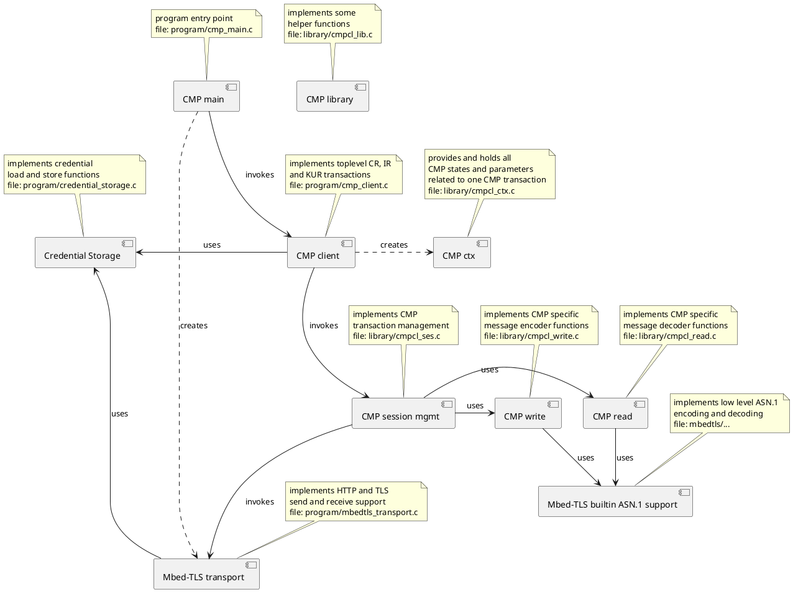

<!-- Copyright (c) 2019 Siemens AG

Licensed under the Apache License, Version 2.0

SPDX-License-Identifier: Apache-2.0 -->

# CMP Client

This project provides source code, documentation, and other files for a CMP client
implementation. This prototypical code explicitly does not have production quality
but constructively proves that CMP can be implemented and used
even on a device that does not have the capacity to contain OpenSSL
nor a proper operating system.

It essentially uses just the cryptography support provided by mbedTLS
and some basic I/O functionality including a bare-bones HTTP or CoAP client.
As expected, its code size, network bandwidth, and computation resource
footprint are similar to an EST implementation (while it does not need (d)TLS
but performs self-contained message protection as far as needed).

This also serves as a PoC for current standardization efforts at the IETF
on profiling the CMP standard 
[RFC 4210](https://tools.ietf.org/html/rfc4210),
[RFC9480](https://tools.ietf.org/html/rfc9480),
[RFC9481](https://tools.ietf.org/html/rfc9481) 
[RFC6712](https://tools.ietf.org/html/rfc6712)
towards use in embedded systems and the IoT.

## License

This software is licensed under the Apache License, Version 2.0.

## Disclaimer

Please note that this software and associated documentation files is a prototypical
implementation and merely serves as proof-of-concept.
It is explicitly not guaranteed that all related functionality and hardening measures
needed for productive software have been implemented.
The development procedures and processes for proof-of-concept implementation are
not sufficient to assure product-grade software quality. Therefore the code, scripts,
configuration, and documentation of the software are provided ‘as is’
and can only serve as an example or starting point for further development.

## How to use

For instructions how to get the required underlying sources
and then build and use this software
please refer to [HOWTO.md](/docs/HOWTO.md).

## Software architecture

The following picture gives a rough overview of the software components used by the embedded CMP client.

